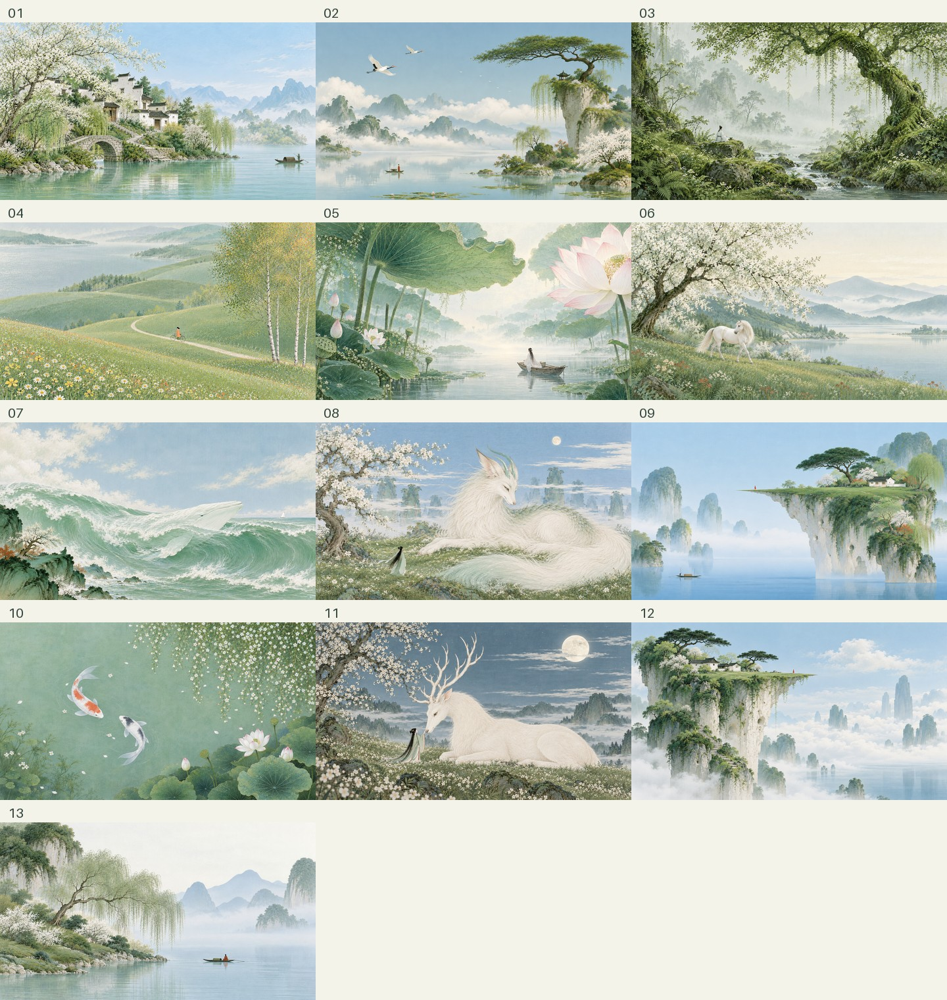

# Create Qinglv Poetic Worlds

一个面向 Codex / ChatGPT 图像生成工作流的青绿东方诗境 Skill。它从山水、锦鲤荷塘、田园丘陵、树下人物与温柔灵兽、海天长卷五类构图中选择主分支，把简洁的大轮廓、细密植物纹理、低饱和青绿配色与安静留白组织成统一画面。

默认生成 16:9、无文字、无边框、无水印的完整插画；也支持竖版重构、系列关键帧与视频连续性设计。

## 特点

- 低至中饱和的鼠尾草绿、青瓷绿、苔绿、灰蓝与象牙白
- 工笔式细线、点绘叶簇、薄层设色和哑光绢布底纹
- 非对称构图，强调“结构简、纹理细、色彩静、生命小、空间奇”
- 五个题材分支及清晰的路由规则，避免把所有元素堆进同一张图
- 近景精细、远景安静，以雾带和降对比建立空间，而非摄影散景
- 限制金碧重彩、仙侠游戏海报、厚重 HDR、霓虹和无请求文字

## 示例



仓库内的 13 张参考图均为该 Skill 的生成作品，并经作者授权公开；不包含最初用于研究风格的第三方图片。

## 安装

```bash
git clone https://github.com/245331830gao-alt/create-qinglv-poetic-worlds.git \
  ~/.codex/skills/create-qinglv-poetic-worlds
```

刷新或重新启动 Codex 后，可直接调用：

```text
使用 $create-qinglv-poetic-worlds 生成一张青绿山水插画。
```

也可以给出更具体的题材：

```text
使用 $create-qinglv-poetic-worlds，创作一张 3:4 的工笔锦鲤荷塘插画，保留中央水域留白。
```

## 题材分支

| 分支 | 适用题材 |
| --- | --- |
| A | 青绿山水、高台幻境、平静水岸 |
| B | 锦鲤荷塘、花叶浮游、苔树秘境 |
| C | 田园丘陵、春秋行旅、日常治愈 |
| D | 树下人物、品茗、温柔灵兽 |
| E | 海天长卷、月夜孤舟、巨浪与海中灵物 |

## 目录结构

```text
create-qinglv-poetic-worlds/
├── SKILL.md
├── agents/
│   └── openai.yaml
├── assets/
│   ├── icon.svg
│   ├── reference-board.jpg
│   └── references/
│       └── 01.png ... 13.png
└── references/
    ├── prompt-recipes.md
    ├── reference-index.md
    ├── style-dna.md
    └── video-continuity.md
```

## 使用边界

- 公开参考图只用于观察配色、构图、疏密、线条和尺度关系，不应复制具体画面、人物、建筑或标识。
- 请只上传或分发你拥有权利、已获授权或法律允许使用的图片。
- Skill 不适合写实摄影、浓墨写意、金碧重彩、仙侠游戏海报或 Q 版人物。
- 图像生成结果仍需检查人物、动物、船只与建筑结构，以及意外文字和水印。

## License

[MIT](LICENSE)

---

## English

This Codex / ChatGPT skill creates quiet East Asian poetic illustrations with muted celadon and sage greens, delicate botanical linework, atmospheric pale-blue layers, asymmetrical compositions, and restrained warm accents.

It routes requests across five scene families: landscapes, koi ponds, pastoral journeys, figures with gentle creatures, and sea-and-sky scrolls. The default output is a clean 16:9 illustration without text, borders, seals, or watermarks.

Install the repository under `~/.codex/skills/create-qinglv-poetic-worlds`, refresh Codex, then invoke `$create-qinglv-poetic-worlds`. See [SKILL.md](SKILL.md) for the full workflow and constraints.
